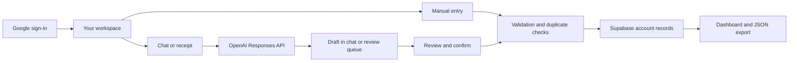

# Paoween v1 · เป๋าวีน

**A personal finance companion that helps you record, understand, and review your money—in Thai.**

Paoween brings everyday transactions, account pockets, investment activity, and tax-preparation records into one workspace. Talk to the assistant, attach a receipt, or enter a record yourself. Review AI-generated drafts before they become part of your ledger.

[Open Paoween](https://paoween-web.vercel.app) · [Developer guide](web/README.md) · [Statement import guide](web/statement_import/README.md)

## Why Paoween

Keeping financial records is only useful when you can make sense of them. Paoween connects transaction entry with spending summaries, a conversational assistant, and a review queue for details that need your attention.

The experience follows one rule: **AI prepares; you confirm.** An uncertain draft can be saved for review without changing your recorded income, expenses, or balances.

## Features

| Feature | What it does |
| --- | --- |
| Dashboard | Shows income, spending, monthly trends, and period filters alongside the animated Paoween assistant. |
| Transaction ledger | Creates, edits, and deletes income, expenses, investments, and transfers with category and period views. |
| Account pockets | Tracks opening balances, transactions, and transfers between pockets, with balances as of a selected date. |
| AI chat and receipts | Streams Thai replies, accepts up to five receipt images, prepares editable transaction drafts, and helps navigate the dashboard. |
| Review queue | Keeps incomplete or uncertain drafts separate until you review and confirm their details. |
| Investment journal | Records buys and sells separately and includes an illustrative return simulator. |
| Tax preparation | Organizes records by Thai tax year, supporting evidence, and review status. |
| Account controls | Provides Google sign-in, account-scoped records, JSON export, and account deletion after reauthentication. |

## From receipt to record

1. **Sign in** with Google and complete the initial setup.
2. **Add a record** manually, describe it in chat, or attach receipt images.
3. **Review the draft.** Clear proposals appear in chat; uncertain proposals go to the review queue.
4. **Confirm the save.** The backend validates the fields and checks for duplicates before creating a transaction.
5. **Explore your finances** through the dashboard, spending views, pockets, investment journal, and tax-preparation records.



## Import pilots

| Pilot | Supported flow | Review boundary |
| --- | --- | --- |
| Dime investments | Creates buy/sell drafts from supported Dime email text or PDFs. Optional Gmail access and PDF password handling run in the browser. | Confirm the trade date, direction, category, and THB amount. Unsupported patterns and scanned PDFs require manual review. |
| Bank statements | Reads supported text or scanned THB statements through a server-side parser and CPU OCR. Selected flagged crops can be sent to OpenAI with consent. | Accept corrections and confirm selected income/expense rows before saving. Use the transfer workflow for movements between your own accounts. |

Statement import accepts one unencrypted, single-currency THB PDF, up to **4 MB, 5 pages, and 120 rows**. It requires separate activation and model assets. These pilots support specific document patterns; they do not cover every bank or broker layout.

See the [statement import guide](web/statement_import/README.md) for setup and the [benchmark report](benchmarks/statement-pdf/RESULTS.md) for the recorded synthetic experiment and its limits.

## Your data

- **Account records** live in Supabase, with account ownership and row-level security. Queued review drafts remain separate from ledger transactions.
- **AI requests** send your submitted message, current receipt images, and limited recent chat history to OpenAI through the server. A scoped account snapshot is included only when you choose to share it.
- **Dime imports** read emails and PDFs in the browser. Saving sends reviewed transaction fields and hashed source references to the server.
- **Statement imports** upload the PDF to the application's Python parser. Sending selected crops to OpenAI requires a separate consent step.
- **Monthly salary setup** is stored in account-keyed browser storage, separately from saved income transactions.

OpenAI requests use `store: false`, and the app records usage and estimated cost. See [data handling](web/README.md#data-handling) for context limits, storage boundaries, and export coverage.

## Run locally

Use **Node.js 24** and npm. First configure Supabase and Google sign-in using the [developer guide](web/README.md), then run:

```sh
cd web
cp .env.example .env.local
# Fill in .env.local before starting the app.
npm ci
npm run dev
```

Open [localhost:3000](http://localhost:3000). AI additionally requires an OpenAI key, an enabled database policy, and an active model-rate entry. Statement OCR requires Python 3.12 and prepared model assets.

The developer guide covers [environment variables](web/README.md#3-set-environment-variables), [Vercel deployment](web/README.md#deploy-to-vercel), and [validation and current known issues](web/README.md#validation).

## Project structure

```text
web/
  app/                    Pages, server actions, and API routes
  lib/finance/            Financial logic, validation, and assistant helpers
  lib/supabase/           Session and server-client helpers
  supabase/migrations/    Schema, access policies, and AI usage accounting
  scripts/                Offline tests, SQL regressions, and AI evaluation
  api/                    Python statement parser
  statement_import/       Statement extraction and pilot guide
  public/paoween/          Mascot assets
benchmarks/statement-pdf/  Synthetic PDF/OCR benchmark and results
```

## v1 scope

Paoween grew from a local finance dashboard and a five-pillar assistant concept. The web version focuses on income and expenses, investment recordkeeping, and tax preparation. Product price comparison and subscription alerts remain outside its scope. The separate local CSV dashboard and its data do not sync automatically to this app.

Pocket balances reflect recorded opening balances and transactions. The investment journal tracks activity rather than live portfolio value, and simulator results are illustrative. Tax-preparation records organize evidence; eligibility for a deduction requires the relevant documents and tax-year rules.

Keep real receipts, financial exports, API keys, and other credentials out of the repository.
