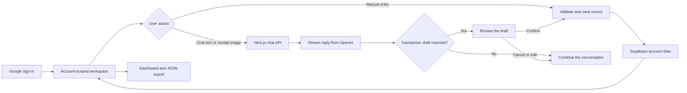

# Paoween v1 · เป๋าวีน

A Thai personal finance web app for tracking money, reviewing tax records, and chatting with Paoween. The chat streams replies and can prepare a transaction draft from a message or receipt image; the user must review and confirm before it is saved.

**Live app:** [paoween-web.vercel.app](https://paoween-web.vercel.app) · **App setup:** [web/README.md](web/README.md)

## Product flow

Chat messages and attached images are sent to OpenAI. Financial context is included only when the user chooses it. Transaction and tax records are stored in the signed-in user's Supabase account. A proposed transaction remains a draft until the user confirms it.

## Earlier pillar plan and v1 scope

The team organized the earlier finance-agent concept into five pillars. The table shows which parts are available in this web app.

| Earlier pillar | Paoween v1 web status |
| --- | --- |
| Income and expenses | Implemented: dashboard, transaction records, spending views, and reviewable receipt/chat drafts. |
| Investment | Implemented: buy/sell journal and an illustrative simulator. The journal does not calculate a live portfolio value. |
| Tax | Implemented as tax-preparation recordkeeping with document and review status; it does not establish that an item is deductible. |
| Product price comparison | Not implemented in this hosted web app. The related helper remains in the separate local app. |
| Subscription alerts | Not implemented in this hosted web app. The local bill calendar remains separate. |

## Project background

The pillar plan and the first working web prototype came from earlier Paoween work. On 21 November 2026, this public repository was created as a clean snapshot of that existing app and deployed to Vercel Production. The initial commit contains the imported baseline; later commits show work added to this repository.

## Run locally

Use Node.js 24 and npm. Follow the [web setup guide](web/README.md) from the `web/` directory. Never commit `.env.local`, API keys, or real financial records.
